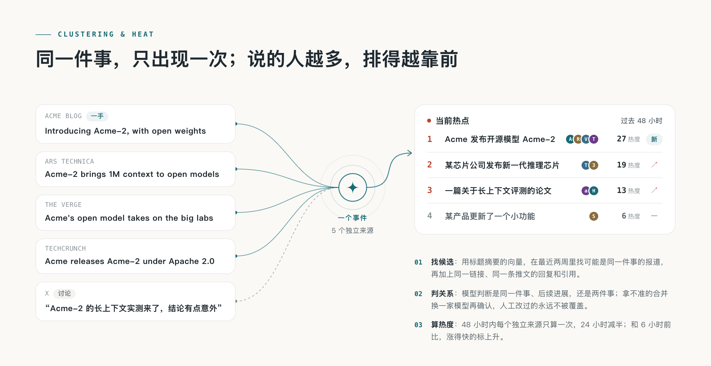

<h1 align="center">Electricity Hot Topics (电力热点宝)</h1>

<p align="center">
  <a href="LICENSE"></a>
  
  
  
</p>

<p align="center">
  <b>Tracks policy releases and market news in the electricity industry, and publishes a daily briefing every morning.</b><br>
  Official releases are classified, scored and summarized as they arrive, and several reports of the same event are merged into one event.
</p>

<p align="center">
  <a href="#getting-started">Getting started</a> ·
  <a href="#where-the-industry-knowledge-lives">Industry knowledge</a> ·
  <a href="#how-it-works">How it works</a> ·
  <a href="#documentation">Documentation</a>
</p>

<br>

## What it is

**电力热点宝 (Electricity Hot Topics)** is a hot-topics site for the electricity industry. Every day it collects material from the public release columns of the National Development and Reform Commission, the National Energy Administration, the State Council's policy portal, the energy regulators and the provincial development and reform departments, plus the announcements of grid and power generation companies. A model screens every item, scores the promising ones twice, independently, and writes a Chinese headline, a summary and a recommendation reason. Reports of the same event from different sources are merged into one event. Every day at 08:00 (Beijing time) it publishes a daily briefing, and the weekly and monthly reports are compiled from the dailies.

It is an **aggregation and summary tool, not a policy-issuing authority.** The site does not republish policy texts in full; it gives summaries and links to the originals, and the official texts published by the issuing authorities always prevail. The terms of use are on the site's [terms page](/terms).

Coverage is mainly official first-party material: policy documents and drafts for comment, electricity pricing and market rules, grid and project progress for each energy type, power operation data, and regulatory enforcement and accident investigations.

## What is in this repository

The website, admin console, selection pipeline, event clustering and heat algorithm, plus **all of this electricity site's knowledge**: categories, tags, the topic catalogue, sources, the full text of every prompt and the selection thresholds. That knowledge lives in the [`site/`](site/) and [`industry/`](industry/) folders; you do not need to change the code in `apps/` and `packages/`.

## Getting started

You need [Docker](https://docs.docker.com/get-started/get-docker/), [Node.js 24](https://nodejs.org/en/download) (to run `init-env`, which generates the configuration) and an OpenAI-compatible model API key.

```bash
node scripts/init-env.ts --llm-key <your model API key>
docker compose up -d --build
```

Open <http://localhost:3000>. The admin console is at `/admin`, and the admin password is in `ADMIN_PASSWORD` in `.env`.

**The column pages of the NEA, the State Council and the energy regulators are rendered in the browser, so their HTML contains no items.** But the data they render is a JSON file that can be fetched directly: for the NEA it is the `ds_*.json` file in the same directory as the column page, and for the State Council it is `ZUIXINZHENGCE.json`. Fetch that JSON directly; no Jina Reader or extra configuration is needed. The NDRC and some provincial portals are rendered on the server and are scraped with CSS selectors.

After you change a source, click "preview fetch" for it on the admin *Sources* page and check the items and dates. The `ds_*.json` file name is the CMS data-source id of the NEA site; it changes when the site is redesigned, and the way to find it is written in the `$nea_json` comment in `industry/sources.json`. See [Sources](docs/sources.md).

Collection and model calls are off by default: `COLLECT_ENABLED` and `MODEL_CALLS_ENABLED` only start them when set to `true`. Without Docker, run the site directly on Linux or macOS (on Windows, use WSL2); see [Deployment](docs/deploy.md).

Once the site is running, `/agent` lists how to connect over MCP, RSS and the API. Agents that can only read web pages start from `/api/v1/agent`, and the interface description is at `/openapi-v1.json`.

## Where the industry knowledge lives

| File | Content |
|---|---|
| `industry/taxonomy.ts` | 12 categories (policy, market, grid, coal power, hydropower, nuclear, wind, solar, storage, data, industry, commentary), the tag vocabulary, the directory of institutions and companies, and the releases that feed the header counts of the daily |
| `industry/topics.json` | The topic catalogue (`/topics`): 36 institutions and companies, business directions and content formats |
| `industry/sources.json` | Demo sources imported on the first start (mainly official first-party sources) |
| `industry/prompts/` | Pre-screening, scoring, writing, structuring, grouping, event digests, weekly and monthly reports, translation. **The judgement standard of this industry is written here** |
| `industry/selection.ts` | Selection thresholds |
| `site/site.ts` | Site name, edition times, home page copy, the About page, and the wording on the daily, weekly and monthly reports |
| `site/pages/` | Terms of use and privacy statement |
| `site/brand/` | Icons, logo and nameplate lettering |
| `site/changelog.json` | Changelog |

**The most worthwhile thing to work on is the scoring standard** (`industry/prompts/selection-score.md`): it says which electricity news counts as important and which counts as noise. The thresholds (`industry/selection.ts`) are still numbers calibrated for another industry. Before going live, recalibrate them on your own samples with `scripts/eval-selection.ts`; see [Selection and calibration](docs/selection.md).

For the order and the meaning of the fields when you change the industry knowledge, see [Customizing it for your industry](docs/customize.md).

## How it works

<picture>
  <source media="(prefers-color-scheme: dark)" srcset="docs/assets/how-dark.png">
  
</picture>

A piece of material comes in from a source, is first checked for duplicates, then pre-screened. Items that may matter are scored twice, independently, and given a Chinese headline and summary; they are clustered with other reports of the same event, and their heat is counted. An item enters the selection only if its score passes the threshold and it is not a duplicate of something already selected. The daily briefing picks the day's main stories by rule, and the weekly and monthly reports are compiled from the dailies. The prompt for each step lives in [`industry/prompts/`](industry/prompts/), so changing the standard does not require changing code. See [Selection and calibration](docs/selection.md).

### Clustering and heat

<picture>
  <source media="(prefers-color-scheme: dark)" srcset="docs/assets/cluster-dark.png">
  
</picture>

The same thing happens once: the official body publishes it, several regulators relay it, and the media report it several times. Readers only need to see it once. These reports are merged into one **event**: candidates from the past two weeks are found by the vectors of their headlines and summaries (without an embedding service, by text overlap), and then a model judges whether they are the same event, a follow-up, or two different events. When it is unsure, it merges, and a model reviews the merge again before it is written.

**Heat is counted per event, not per article.** Within 48 hours each independent source counts once, and a source's contribution halves after 24 hours. Repeated crawls add nothing, so the events at the top are the ones that many independent sources are really talking about.

### What you get

| | |
|---|---|
| **Six kinds of sources** | RSS, web listings, JSON APIs, X accounts, WeChat official accounts, and content your own scripts push in. Sources fall into three tiers (official first-party, official and quasi-official accounts, media and individuals), each with its own selection threshold; crawl frequency adjusts automatically to how often a source publishes |
| **Selection** | Pre-screening, then the same scoring standard applied independently twice, and a threshold by source tier decides what is selected; one news event takes one slot, and rewordings of the same story are not selected again. The prompts and thresholds are all public and all changeable; calibrate them on your own labelled samples in SelectBench |
| **Writing** | Chinese headlines, summaries that answer the question first, recommendation reasons, full translations of foreign-language texts; categories, tags and news facts are extracted separately; the model is kept from naming institutions the original text does not mention |
| **Clustering** | Reports of the same event from different sources become one event; later developments hang under the same event, and the event page has a digest; attributions corrected by people are never overwritten |
| **Heat** | Heat is counted per event: more independent sources rank higher; compared with six hours ago, fast-rising items are marked as rising and newly appearing ones as "new" |
| **Daily, weekly and monthly reports** | A daily briefing every day (08:00 by default), composed by rule: one entry per event, and an event already reported gets a follow-up only when there is new development. A weekly report on Mondays and a monthly report on the 1st, compiled from the dailies. Edition times are set by `EDITION_TIMES` in `site/site.ts` |
| **Topics and search** | Topic pages in three groups (institutions and companies, business directions, content formats); search over headlines and summaries, and relevance search over full text |
| **For agents** | RSS (selected, all, full text, daily, weekly and monthly), the public API, MCP, Agent Markdown and `llms.txt`: the same content for people and for agents |
| **Admin** | Source management and trial fetches, content diagnostics, selection evaluation, a separate model for each step, budget circuit breakers for paid services, run records and alerts |

## Documentation

| Document | Content |
|---|---|
| [Sources](docs/sources.md) | How the six kinds of sources are configured, tiers and full text, crawl frequency, old items and archives, the fixed start point `publishedAfter`, the external push interface |
| [Selection and calibration](docs/selection.md) | How an item becomes a selected item and enters the daily, weekly and monthly reports, and how to calibrate on your own samples |
| [Event grouping and relation evaluation](docs/grouping.md) | How relations between events are judged, and how to evaluate them on your own labelled pairs |
| [Event digest evaluation](docs/story-digest-evaluation.md) | How to run the current and candidate digest prompts side by side on the same events before changing the prompt |
| [Deployment](docs/deploy.md) | Docker, domains and HTTPS, mainland China, updates, backups, cost, and running without Docker |
| [Architecture](docs/architecture.md) | The three processes, the rules that do not change, directories, modules, database migrations, public outputs, tests |
| [Customizing it for your industry](docs/customize.md) | Where to change the site name, categories, topics, sources, prompts, thresholds and branding when you switch to another industry |

Tech stack: Node.js 24 · TypeScript · React Router (server-side rendering) · Fastify · PostgreSQL · pg-boss · Tailwind CSS · Docker Compose.

## License

The code is under the [MIT License](LICENSE). Fonts have their own licenses; see [NOTICE](NOTICE). The framework code is derived from an MIT-licensed open-source project, and its copyright belongs to the original author. This site's name, icons, copy and industry knowledge are unrelated to that project and do not use its name or logo.
