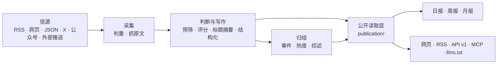

# 架构

## 三个进程

| 进程 | 位置 | 做什么 |
|---|---|---|
| api | `apps/api/` | Fastify：网站接口、公开 API、RSS、MCP、后台接口 |
| worker | `apps/worker/` | pg-boss 任务队列和定时任务：抓信源、调模型、归组、成刊 |
| web | `apps/web/` | React Router 服务端渲染。**只通过 HTTP 读 api** |

业务代码都在 `packages/backend/`，前后端共用的类型和常量在 `packages/contracts/`。

## 几条不变的规则

<AccordionGroup>
  <Accordion title="一个公开读取层" icon="layer-group">
    网页、RSS、API、MCP、站点地图、分享图读的都是 `packages/backend/src/publication/`。新增出口也走这里。
  </Accordion>
  <Accordion title="页面不调模型" icon="ban">
    读者打开页面只读数据库里已经有的结果；模型只在 worker 的任务里调用。
  </Accordion>
  <Accordion title="花钱的请求有回执" icon="receipt">
    每个付费请求先记一张回执，拿到结果先存再用。重试时复用，不重复花钱。
  </Accordion>
  <Accordion title="公开内容匿名" icon="mask">
    管理员和访客看到的一样；读者的收藏、已读存在浏览器里。后台只允许管理员。
  </Accordion>
  <Accordion title="来源可追溯" icon="link">
    每条精选都链接原文；站内是否显示全文由信源的 `site_fulltext` 决定。
  </Accordion>
</AccordionGroup>

这些模块边界由 `tests/architecture.test.ts` 检查；调整边界时同时更新约定与检查。

## 目录

| 位置 | 内容 |
|---|---|
| `site/` | 这个站自己的：站名文案、每一步的模型、品牌、条款页、更新日志 |
| `industry/` | 行业包：分类标签、主题、示范信源、提示词、门槛 |
| `modules/` | 只属于这个站的功能，一个功能一个文件夹 |
| `packages/backend/src/publication/` | 公开读取层 |
| `database/migrations/` | 数据库迁移，按完整文件名排序执行和记账 |

## 数据库迁移

从 `0055` 起，每个文件只放**一条**允许在线执行的语句，PR 会检查。索引使用 `CONCURRENTLY IF NOT EXISTS`，大批数据回填不放进发布迁移。已经发布的迁移不改。